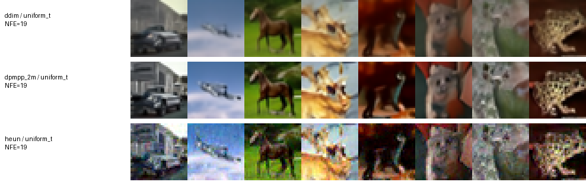

# Первое сравнение собственных сэмплеров

Дата: 5 ноября 2026 года. Это локальный pilot на 16 изображениях, а не полный
baseline РК 1 и не оценка FID. Цель — проверить рабочие реализации, сопоставимость
вычислительного бюджета и близость к длинной детерминированной генерации.

## Условия

Модель google/ddpm-cifar10-32, ревизия 267b167dc01f0e4e61923ea244e8b988f84deb80,
веса заморожены. Устройство — M4 Pro через PyTorch MPS. Точность float32,
batch size 8, один прогревочный батч, два измеренных батча.
PyTorch 2.11.0, Diffusers 0.35.2, torchvision 0.26.0.

Все методы используют одинаковые сохранённые шумы с seeds 10000–10015,
uniform_t-сетки с одинаковыми крайними точками и clipping=False.
На изображение приходится 19 NFE: 19 узлов DDIM/DPM-Solver++, 10 узлов Heun.
Время включает денойзинг и подготовку сетки; загрузка, прогрев, запись и метрики исключены.

## Измерения

MSE считается по сырым float32-выходам относительно собственного DDIM с 1000 NFE
на тех же шумах и диапазоне. Это численный эталон, не истинное изображение.

| Метод | NFE | Секунд на изображение | MSE к DDIM 1000 | Стандартная ошибка средней MSE |
|---|---:|---:|---:|---:|
| DDIM | 19 | 0.0936 | 0.007736 | 0.001096 |
| DPM-Solver++ 2M | 19 | 0.0951 | 0.001713 | 0.000214 |
| Heun | 19 | 0.0993 | 0.015719 | 0.002763 |

Средняя MSE между DDIM 500 и DDIM 1000 — 0.000005230. На этих 16 шумах это
существенно меньше ошибок коротких траекторий. Проверка поддерживает использование
длинного эталона в pilot; для других шумов и настроек сходимость ещё нужно проверить.



## Что можно утверждать

В этом конкретном pilot DPM-Solver++ 2M ближе к длинной DDIM-генерации по MSE.
Разница показывает, что методы ведут себя по-разному даже при равном NFE.
Heun здесь использует более редкую сетку, поскольку тратит два вызова на обычный
интервал. Его поведение на других расписаниях пока не исследовано.

По этим данным нельзя объявлять лучший метод по качеству: FID не вычислен,
шумов только 16, расписание одно. Время измерено на MPS по двум батчам;
выводы о скорости на T4 требуют отдельных запусков и повторов.

## Проверка численной корректности

На настоящей модели проверены пять случаев с двумя фиксированными шумами.
Сравнивались все завершённые шаги с Diffusers, с тем же начальным состоянием.

| Метод и режим | NFE | Максимальная абсолютная ошибка среди шагов |
|---|---:|---:|
| DDIM native, clipping=True | 20 | 0 |
| DPM-Solver++ 2M, karras, clipping=False | 19 | 0.000002138 |
| Heun, karras, clipping=False | 19 | 0 |
| DPM-Solver++ 2M, log_sigma, clipping=True | 19 | 0.000001669 |
| Heun, log_sigma, clipping=True | 19 | 0 |

В эталоне Heun sigma перенесены на MPS после set_timesteps. Это устраняет обнаруженное
в этой среде ошибочное смешивание CPU-скаляров с MPS-тензорами без изменения формул.
Проверки точного совпадения не заменяют эксперименты с качеством.

## Воспроизведение

```bash
python scripts/verify_samplers.py --device mps --local-files-only
python scripts/run_sampler_pilots.py --device mps --local-files-only --references both
```

Сырые результаты и полные manifests сохраняются локально в results/. В репозиторий
включены только эта сводка, небольшой рисунок и компактный JSON с измерениями.
Полные артефакты нужны для аудита контрольных сумм и повторных расчётов MSE.

Следующие эксперименты: полноценный baseline на T4 с FID, сравнение расписаний и
бюджетов на большей выборке, подбор опорных точек на calibration, проверка на
validation и независимых шумах, затем перенос расписания на другой сэмплер.
