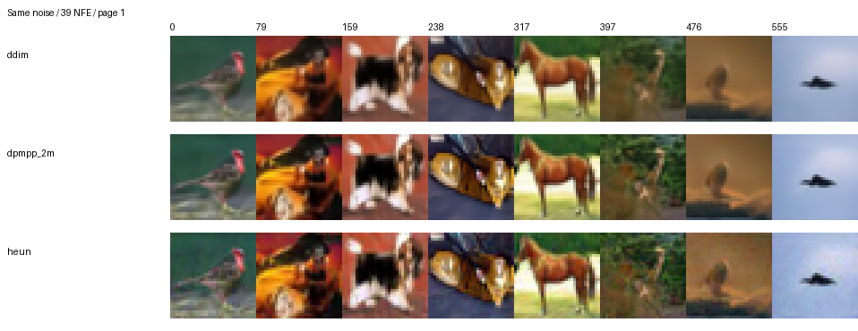
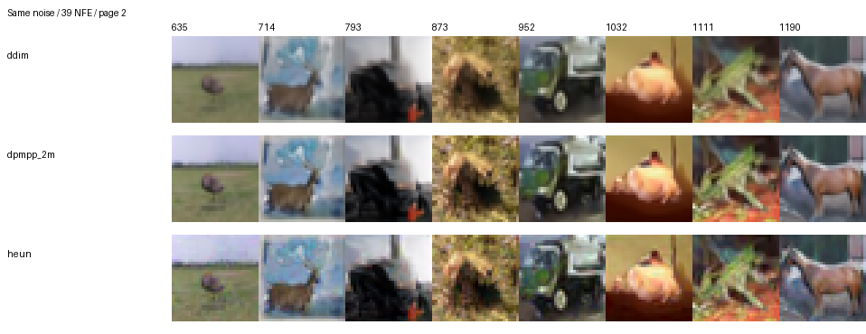
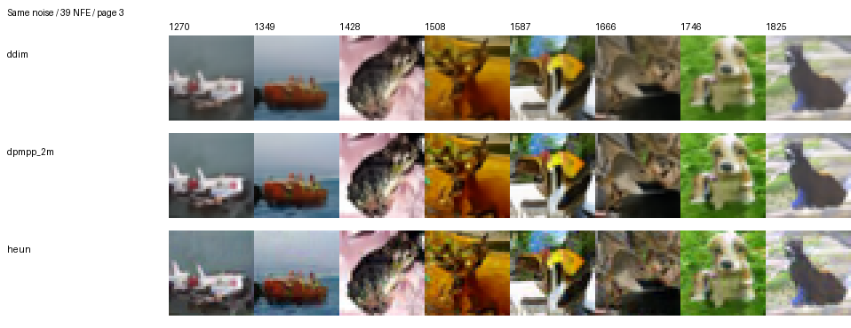
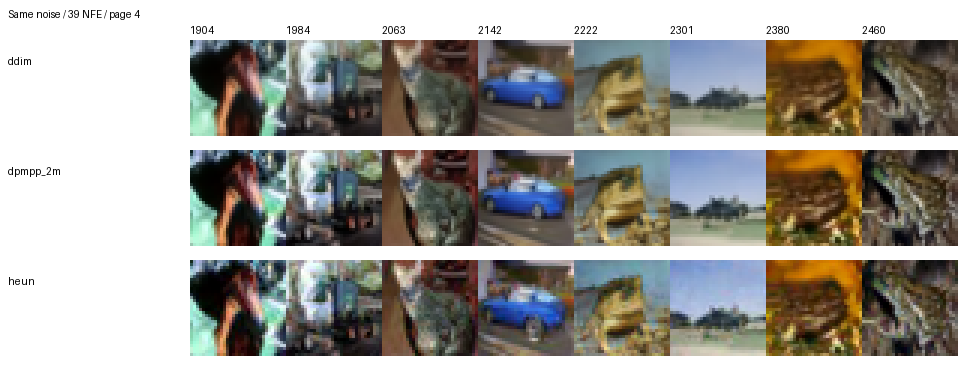
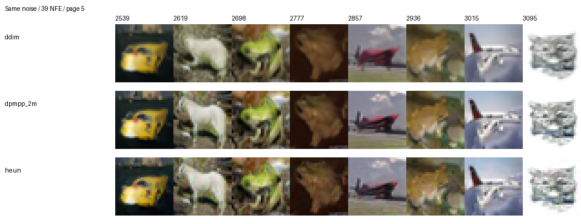
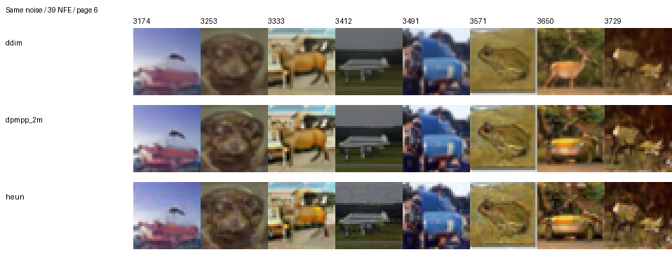
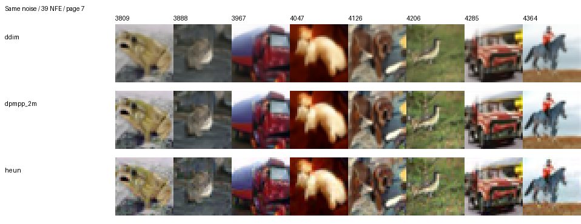
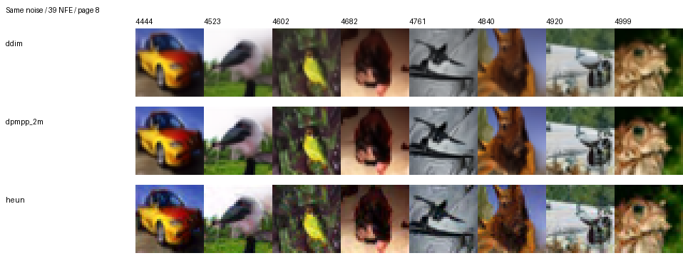

# Сравнение сэмплеров на T4 при 39 NFE

Модель google/ddpm-cifar10-32, общий сохранённый банк из 5000 шумов,
uniform_t, clipping=False, float32, batch size 64. Контрольные суммы, тензоры,
соответствие PNG и метрик проверены локально по финальным архивам.

| Метод | FID ↓ | Денойзинг, с | Секунд на изображение |
|---|---:|---:|---:|
| DDIM | 20,8112 | 548,78 | 0,1098 |
| DPM-Solver++ 2M | 18,7129 | 558,05 | 0,1116 |
| Heun | 27,0767 | 558,56 | 0,1117 |

DPM-Solver++ 2M получил минимальный FID в этом эксперименте. Вывод относится
к одному банку шумов и расписанию uniform_t. Подтверждение на независимых
шумах запланировано в ноутбуке 04.

Визуальный просмотр охватывает 64 одинаковых индекса каждого метода,
равномерно распределённых по диапазону 0–4999. На части примеров у DPM-Solver++ 2M
более отчётливые контуры, у Heun заметнее зернистость. У всех методов встречаются
размытые детали и неоднозначные формы. Подробные наблюдения находятся в
[DDIM](visual_reviews/ddim_uniform_t_nfe39.md),
[DPM-Solver++ 2M](visual_reviews/dpmpp_2m_uniform_t_nfe39.md) и
[Heun](visual_reviews/heun_uniform_t_nfe39.md).

